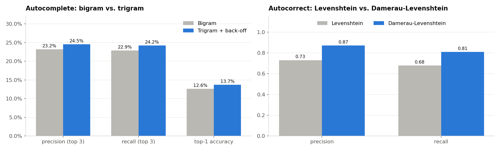
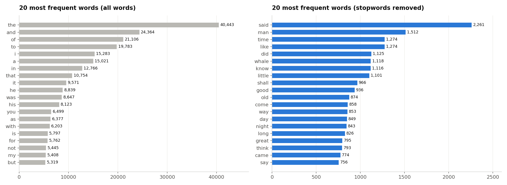
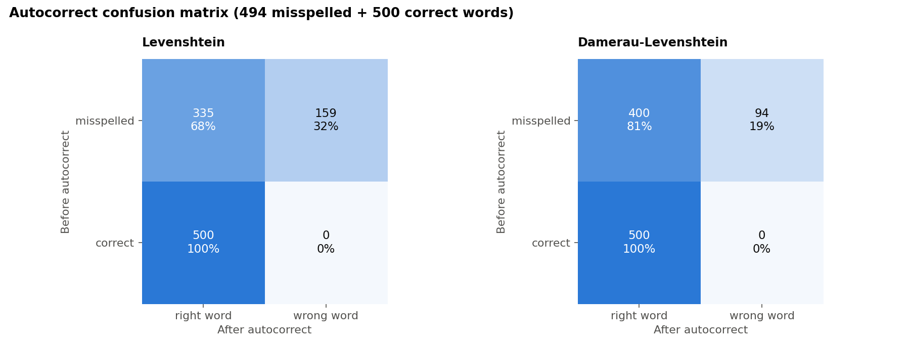

# Autocomplete and Autocorrect Data Analytics
**Oasis Infobyte Internship · Data Analytics · Level 2 — Task 5**  
**Author:** Ojewumi Asaph Felix

## Objective
Build and evaluate the two text-prediction features of a keyboard — **autocomplete** (predict the next word) and **autocorrect** (fix a misspelled word) — compare two approaches for each, and measure their precision and recall.

## Corpus
6 public-domain novels from [Project Gutenberg](https://www.gutenberg.org/) (in [`data/`](data/)): *Pride and Prejudice*, *The Adventures of Sherlock Holmes*, *Moby Dick*, *Frankenstein*, *A Tale of Two Cities*, *Dracula* — **35,024 sentences, 827,433 words**, split 90 % training / 10 % test.

**Notebook:** [`autocomplete_autocorrect.ipynb`](autocomplete_autocorrect.ipynb)

## Tech Stack
Python · pandas · numpy · matplotlib · collections · scikit-learn (stopword list) · Jupyter Notebook — the n-gram models and edit-distance algorithms are **implemented from scratch**.

## Method
1. **Preprocessing**: sentence splitting, lowercasing, tokenisation, punctuation removal; stopwords removed **only** for the frequency analysis (they are kept for autocomplete, because they are the words people type most)
2. **Autocomplete**: frequency-based **bigram** vs. **trigram with bigram back-off**, top-3 suggestions, tested on 10 prefixes
3. **Autocorrect**: **Levenshtein** (insert, delete, substitute) vs. **Damerau-Levenshtein** (+ adjacent transposition), candidates at distance 1 then 2, most frequent word wins
4. **Evaluation**: precision and recall for both features, on all 82,082 test words (autocomplete), on 25 common real-life typos and on 494 synthetic typos + 500 correct words (autocorrect)

## Results
**Autocomplete (top-3 suggestions)**

| Model | Precision | Recall | Top-1 accuracy |
|---|---|---|---|
| Bigram | 23.2 % | 22.9 % | 12.6 % |
| **Trigram + back-off** | **24.5 %** | **24.2 %** | **13.7 %** |

**Autocorrect**

| Algorithm | Precision | Recall | Common typos fixed | False alarms |
|---|---|---|---|---|
| Levenshtein | 0.73 | 0.68 | 17 / 25 | 0 |
| **Damerau-Levenshtein** | **0.87** | **0.81** | **23 / 25** | 0 |



## Key findings
- Using **two words of context** (trigram) gives more natural suggestions (*"do not"* → *know, think, fear*), but the gain is small with only 830k words of training text.
- Handling **swapped letters** is decisive for autocorrect (*teh* → *the* instead of *ten*).
- **7 % of typos produce another valid word** (*from* → *form*): a dictionary-based corrector cannot detect them.
- Frequency alone sometimes picks the wrong word (*wich* → *with*, *adress* → *dress*).

## Limitations vs. Google Keyboard
Small 19th-century corpus vs. billions of modern words; n-grams vs. neural models using the whole sentence; no keyboard layout, touch position or personalisation; no detection of real-word errors.

## Charts
| Most frequent words | Autocorrect confusion matrix |
|---|---|
|  |  |

## How to run
```bash
pip install pandas numpy matplotlib scikit-learn jupyter
jupyter notebook autocomplete_autocorrect.ipynb
```

## Demo video
_(LinkedIn link — to be added)_
