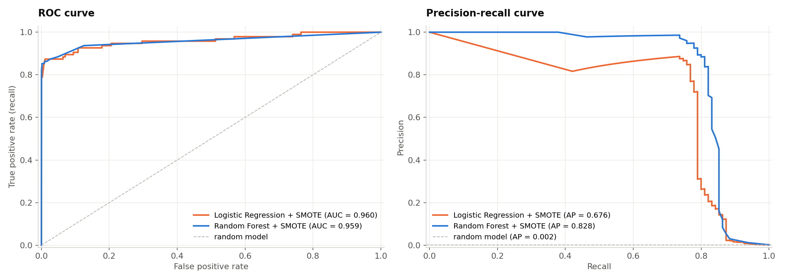
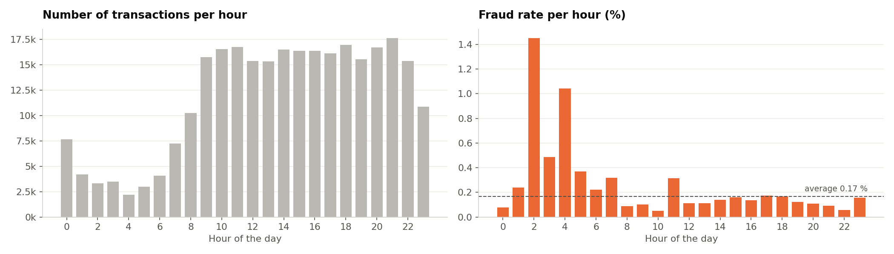
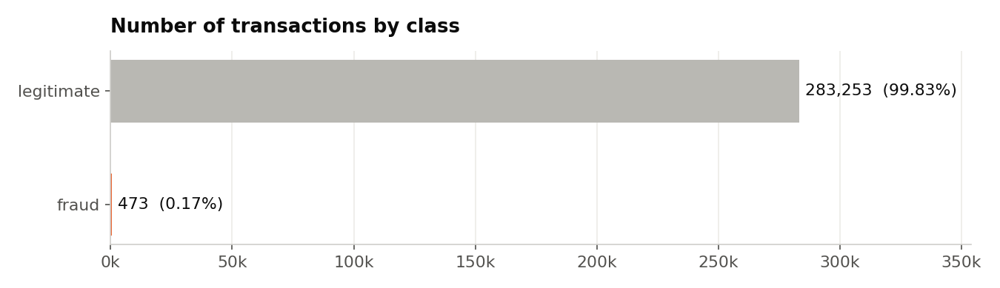
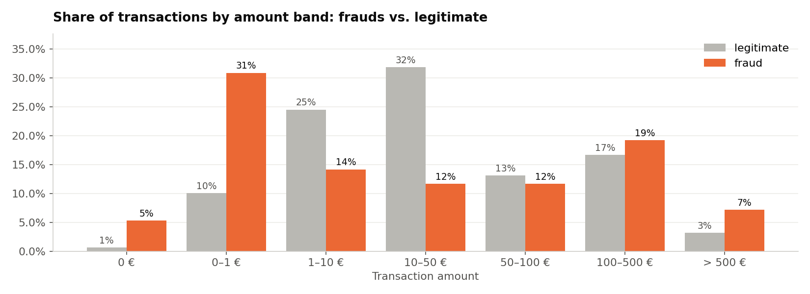
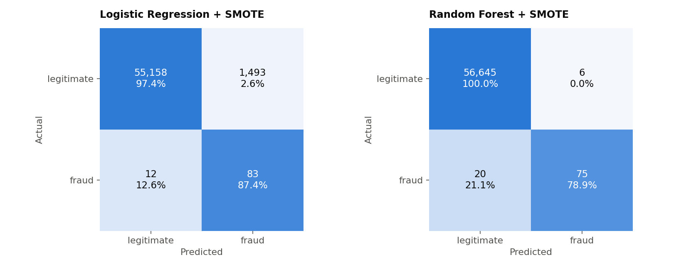
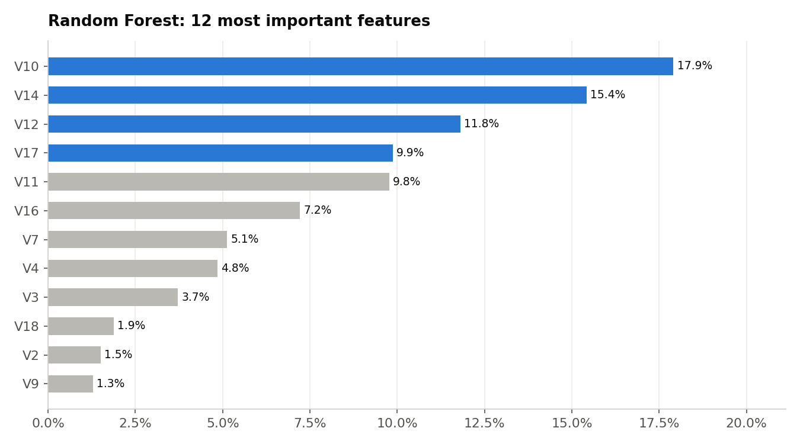

# Credit Card Fraud Detection
**Oasis Infobyte Internship · Data Analytics · Level 2 — Task 3**  
**Author:** Ojewumi Asaph Felix

## Objective
Build a machine learning pipeline that detects fraudulent credit card transactions in a heavily imbalanced dataset, and evaluate it with the right metrics.

## Dataset
- **Source:** *Credit Card Fraud Detection* (ULB Machine Learning Group / Worldline, Kaggle), downloaded from [OpenML (dataset 1597)](https://www.openml.org/d/1597)
- **File:** [`data/creditcard.csv.gz`](data/creditcard.csv.gz): 284,807 transactions by European cardholders over 2 days (September 2013), **492 frauds**; `V1`–`V28` are anonymised PCA components, plus `Time` and `Amount` (€)
- **Notebook:** [`fraud_detection.ipynb`](fraud_detection.ipynb)

## Tech Stack
Python · pandas · numpy · scikit-learn · imbalanced-learn (SMOTE) · matplotlib · Jupyter Notebook

## Method
1. **Inspection**: no missing values, 1,081 duplicated transactions removed → 283,726 transactions, **473 frauds (0.17 %)**
2. **EDA**: amounts of frauds vs. legitimate payments, **time-of-day analysis** (fraud rate per hour)
3. **Why accuracy is misleading**: "never fraud" is 99.83 % accurate and catches 0 frauds
4. **Stratified 80/20 split** (95 frauds in the test set)
5. **Imbalance handling** compared on Logistic Regression: nothing / `class_weight="balanced"` / **SMOTE** (training data only, inside the pipeline)
6. **Models**: Logistic Regression + SMOTE, **Random Forest + SMOTE**
7. **Evaluation**: precision, recall, F1, ROC AUC, PR AUC, confusion matrices, ROC and precision-recall curves, threshold analysis
8. **Feature importance** and **scalability** test

## Results
| Model | Precision | Recall | F1 | ROC AUC | PR AUC |
|---|---|---|---|---|---|
| Logistic Regression + SMOTE | 0.053 | 0.874 | 0.099 | 0.960 | 0.676 |
| **Random Forest + SMOTE** | **0.926** | **0.789** | **0.852** | 0.959 | **0.828** |

The Random Forest catches **75 of the 95 test frauds** with only **6 false alarms** out of 56,651 legitimate transactions. Logistic Regression catches 83 frauds but raises 1,493 false alarms.



## Key findings
- **36 % of frauds are 1 € or less** (card testing), and frauds are also over-represented above 100 €.
- **Fraud rate peaks at night**: 1.45 % at hour 2 and 1.04 % at hour 4 (6 to 9 times the average).
- **Recall vs. precision**: a missed fraud costs more than a false alarm, so recall is the priority, but precision must stay high enough for analysts. Threshold 0.3 instead of 0.5: +2 frauds caught for +8 false alarms.
- Most important features: **V10, V14, V12, V17, V11**.



## Scalability
1 million transactions per hour = ≈ 280 per second. The Random Forest scores **≈ 300,000 transactions per second** on a laptop, so prediction is not the bottleneck. Production challenges: real-time integration (API / streaming), latency, regular retraining against changing fraud tactics, delayed labels, and analyst capacity.

## Limitations
Two days of data from 2013; anonymised features; only 95 frauds in the test set.

## Charts
| Class imbalance | Amounts | Confusion matrices | Feature importance |
|---|---|---|---|
|  |  |  |  |

## How to run
```bash
pip install pandas numpy scikit-learn imbalanced-learn matplotlib jupyter
jupyter notebook fraud_detection.ipynb
```

## Demo video
_(LinkedIn link — to be added)_
