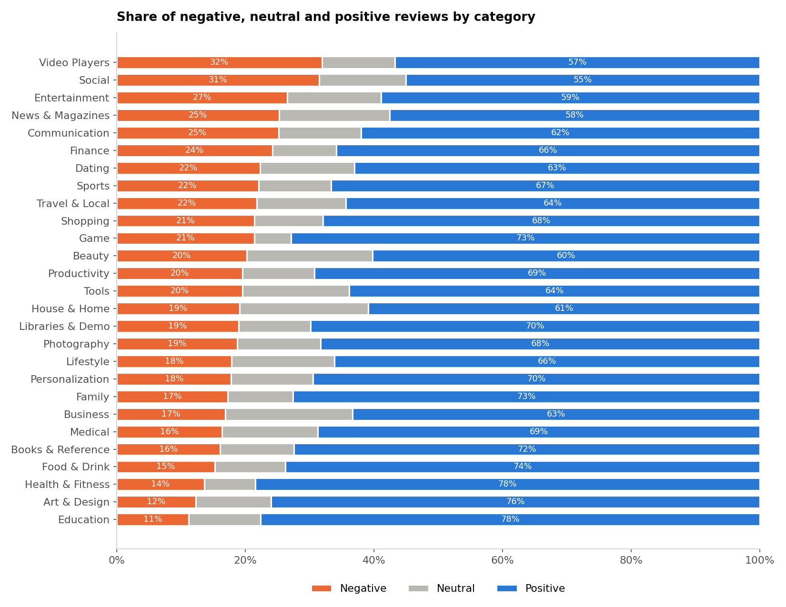
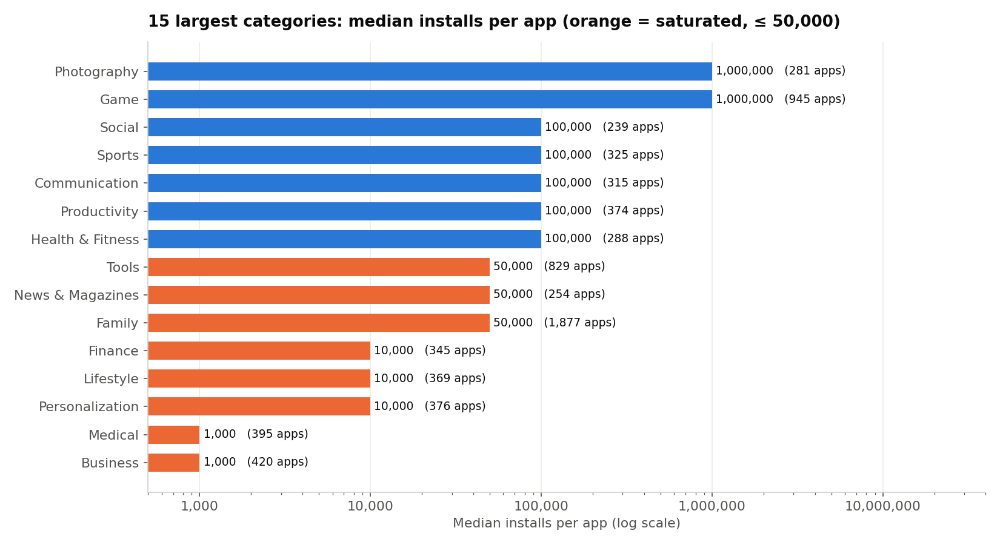
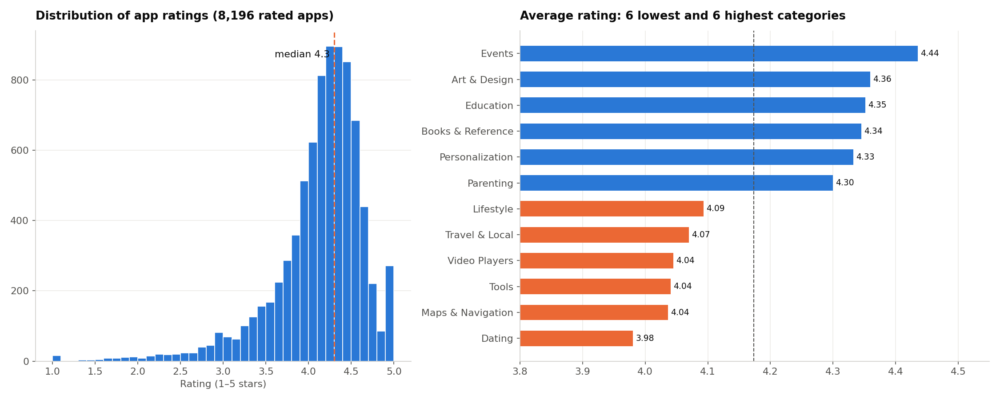
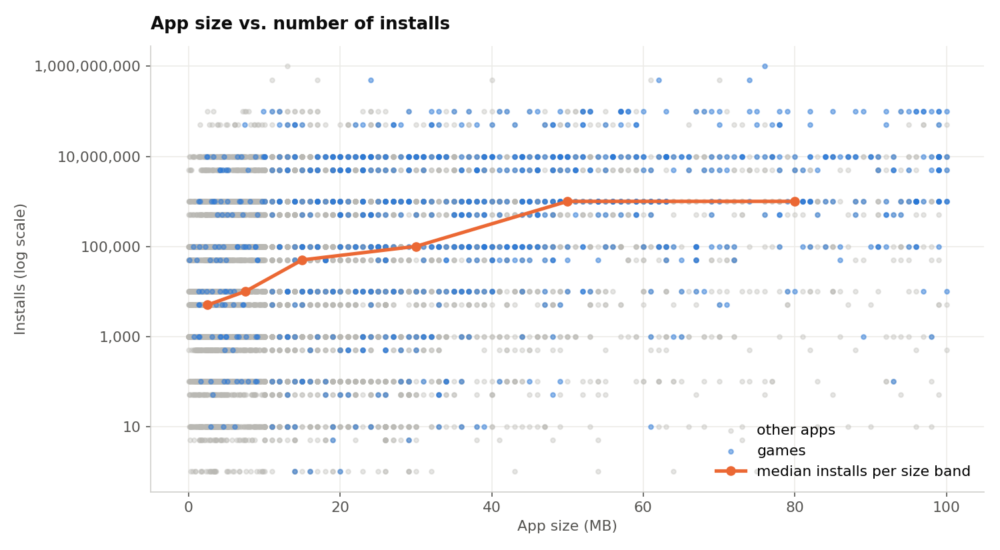
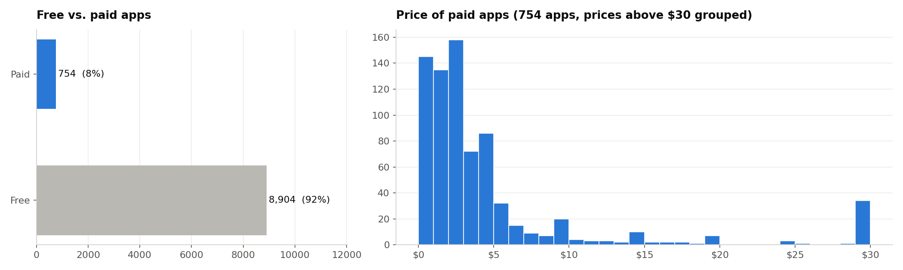
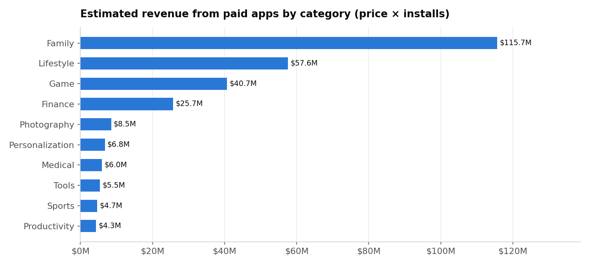
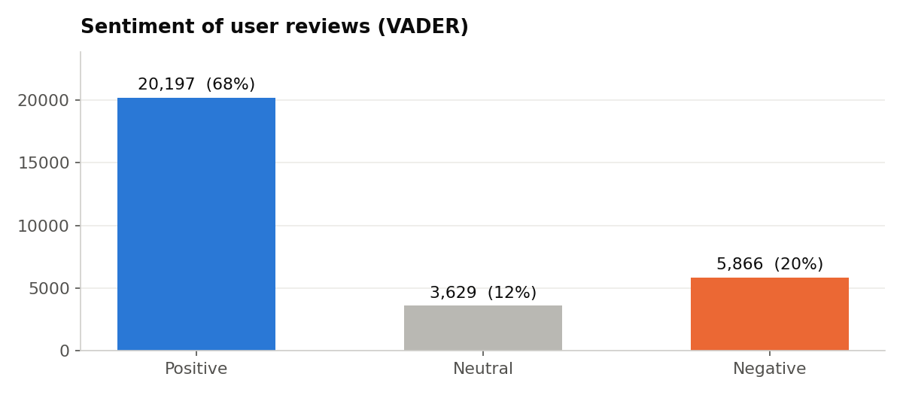

# Unveiling the Android App Market — Google Play Store Analysis
**Oasis Infobyte Internship · Data Analytics · Level 2 — Task 4**  
**Author:** Ojewumi Asaph Felix

## Objective
Clean messy real-world data about Google Play apps, explore categories, ratings, sizes and prices, analyse the sentiment of user reviews, and give data-driven advice to a developer planning a new app.

## Dataset
*Google Play Store Apps* (Lavanya Gupta, Kaggle, scraped in 2018):
- [`data/googleplaystore.csv`](data/googleplaystore.csv): 10,841 apps — copy of the original Kaggle file, checked byte for byte (SHA-256)
- [`data/googleplaystore_user_reviews.csv`](data/googleplaystore_user_reviews.csv): 64,295 user reviews
- **Notebook:** [`playstore_analysis.ipynb`](playstore_analysis.ipynb)

## Tech Stack
Python · pandas · numpy · matplotlib · plotly · VADER (vaderSentiment) · Jupyter Notebook

## Data cleaning
- Removed **1 corrupted row** (values shifted by one column)
- Converted text columns to numbers: `Installs` ("10,000+"), `Price` ("\$4.99"), `Size` ("19M", "201k", "Varies with device"), `Reviews`, `Last Updated`
- **Duplicates**: 483 exact duplicates and 1,181 repeated apps → kept the most recent snapshot of each app (most reviews) → **9,659 unique apps**
- Missing ratings (≈ 15 %) **not imputed**, excluded from the rating analysis
- Reviews: 26,868 empty and 7,735 duplicated rows removed → **29,692 unique reviews** (865 apps)

## Key findings
| | |
|---|---|
| Most saturated categories | **Family** (1,877 apps) and **Tools** (829): median 50,000 installs; **Business / Medical**: median 1,000 |
| Big audiences | **Game, Education, Photography, Entertainment, Shopping**: median **1 million installs** |
| Ratings | median **4.3**; best: Events, Art & Design, Education; lowest: Dating, Maps, Tools |
| Size vs. installs | weak positive link (Spearman 0.31): size is not a barrier |
| Pricing | **92 % free**; median paid app **\$2.99**; revenue from paid apps concentrated in a few hits (Minecraft ≈ \$70M) |
| Review sentiment (VADER) | **68 % positive**, 20 % negative, 12 % neutral |
| Most negative categories | **Video Players** and **Social** (≈ 32 % negative reviews) |



## 3 insights for a developer
1. **Choose a less saturated category with a large audience**, e.g. Education: fewer apps, median 1M installs, the most positive reviews.
2. **Launch for free and monetise with in-app purchases, subscriptions or ads**: paid apps rarely sell above \$5.
3. **Quality and stability decide the reviews**, especially in Video Players and Social, where 1 review in 3 is negative.

## Interactive chart
The notebook includes a **plotly** bubble chart (competition, audience, total installs and rating per category). GitHub cannot display it: open [`images/category_map.html`](images/category_map.html) in a browser.

## Charts
| Saturation | Ratings | Size vs. installs |
|---|---|---|
|  |  |  |
| **Pricing** | **Revenue by category** | **Review sentiment** |
|  |  |  |

## Limitations
Data scraped in 2018; installs are lower bounds; reviews cover 865 apps; revenue ignores in-app purchases and ads; VADER is a rule-based approximation.

## How to run
```bash
pip install pandas numpy matplotlib plotly vaderSentiment jupyter
jupyter notebook playstore_analysis.ipynb
```

## Demo video
_(LinkedIn link — to be added)_
